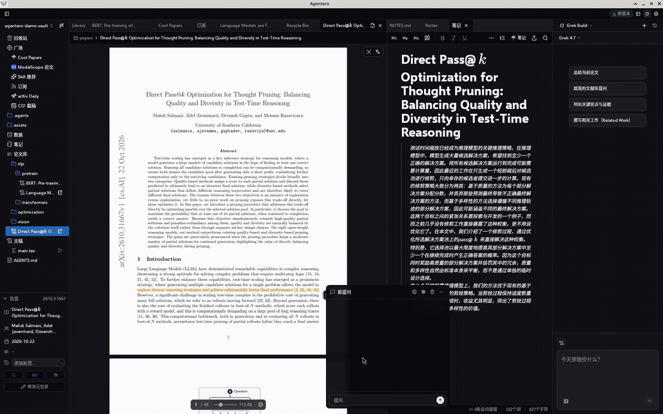

# Agentero

<p align="center">
  
</p>

<h3 align="center">从划线到成稿，不用再复制粘贴给 Agent。</h3>

<p align="center">
  从读到写，人与 Agent 共用同一份科研上下文。
</p>

<p align="center">
  <a href="https://github.com/poco-ai/agentero/stargazers"></a>
  <a href="https://github.com/poco-ai/agentero/releases"></a>
  <a href="LICENSE"></a>
  <a href="https://agentero.app/"></a>
  <a href="https://docs.agentero.app"></a>
</p>

<p align="center">
  <sub>The all-in-one research workspace for humans and agents</sub>
  &nbsp;·&nbsp;
  <b>中文</b> | <a href="README.en.md">English</a>
</p>

<p align="center">
  给已经在用 Claude Code / Codex 的 AI 方向研究生。
</p>

<p align="center">
  
  <br/>
  <sub>打开论文 → 划线 → 侧栏问 Agent（写作和编译部分的完整录屏待补）</sub>
</p>

---

## 现在的麻烦

- 论文在 Zotero，问题贴进聊天框，上下文要靠复制粘贴硬凑
- Agent 读不懂双栏 PDF、公式和表格，经常答非所问
- 写 Related Work 或改稿时，上下文又断一次，还得再贴一遍

Agentero 是本地工作区。你自己的 Agent 可以直接读文献库和草稿，改动由你决定保留或撤销。

---

## 能做什么

**阅读**

把 PDF 里的图表、公式、表格抽成结构化 Markdown / LaTeX，Agent 按真实内容来读。

**接自己的 Agent**

用 ACP / MCP 接入 Claude Code、Codex 等。不绑某一家，Key 在你手里，文献库留在本地文件夹。

**写论文**

内置 LaTeX。保存后自动编译，双击 PDF 可用 SyncTeX 跳回源码。Agent 改 `.tex`，你在 Diff 里决定要不要留下。

---

## 数据和迁移

- Vault 是普通文件夹（PDF + Markdown），可以用 Git、S3 或 WebDAV 同步
- 用 ACP 接本机 Agent，也可以当 MCP Server，给外部客户端用
- 可以从 Zotero 一键导入标签、笔记和附件，并导出 BibTeX / BibLaTeX。不替代 Zotero，只是让人和 Agent 共用同一份库

截图、广场、Skill、同步等细节见 [文档](https://docs.agentero.app)。

---

## 快速开始

### 桌面客户端（macOS / Windows / Linux）

前往 **[官网](https://agentero.app/)** 或 **[GitHub Releases](https://github.com/poco-ai/agentero/releases)** 下载。

#### macOS（Homebrew）

```bash
brew tap poco-ai/agentero
brew install --cask agentero
```

> Linux：Ubuntu 22.04+（`webkit2gtk 4.1`），详见 [安装文档](docs/usage/getting-started.md)。

### 命令行（CLI）

```bash
brew tap poco-ai/agentero
brew install agentero
agentero --help
```

---

## 致谢与社区

感谢 [LinuxDo](https://linux.do/)、[ModelScope 魔搭社区](https://modelscope.cn/) 的早期反馈，以及 [AtomGit](https://gitcode.com/poco-ai/Agentero) 国内镜像。

有帮助的话，给个 **⭐ Star**。本项目基于 [MIT License](LICENSE) 开源。


